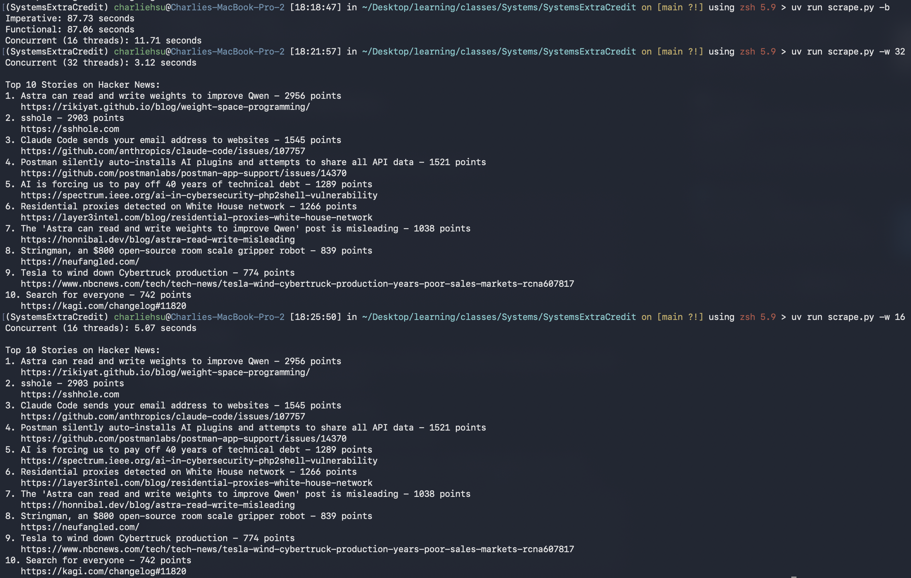

# SystemsExtraCredit
## Web Scraper for Hacker News
A small script to find the 10 highest-scoring stories currently on Hacker News. It uses the official Hacker News API, fetches stories in parallel with concurrent.futures, and processes them with map, filter, and sorted.

## Usage
Requires Python3 and requests:
```
pip install requests
```
Run it with
```
python3 scrape.py
```
Options:
```
Usage: python3 scrape.py [-w WORKERS] [-b]

    -w WORKERS  Number of threads (default: 16)
    -b          Compare imperative, functional, and concurrent versions
    -h          Show this help message
```
Examples:
```
python3 scrape.py          # top 10 stories using 16 threads
python3 scrape.py -w 4     # use 4 threads instead
python3 scrape.py -b       # benchmark all three versions
```
The script gets the IDs of the current top 500 stories, fetches each one, drops deleted posts and job listings, sorts by points, and shows the top 10.
## Demo

## Performance
Functional Programming and Concurrency effects can be seen through three versions of the same scraper:
1. scrape_imperative uses a for loop with if and append, fetching one story at a time.
2. scrape_functional does the same thing with map, filter, and sorted, still one story at a time.
3. scrape_concurrent is the functional version, but uses executor.map from a ThreadPoolExecutor to fetch stories in parallel.

Results can be seen in the demo image above.

### Functional Programming

Switching from a loop to map/filter/sorted made basically no difference in speed. Almost all of the run time is spent waiting for HTTP responses, and both versions make the same 500 requests one after another. map and filter are lazy, so the functional version doesn't build an extra list as it goes, but that saving is tiny compared to the network time. 

The other benefit is in how the code is structured. The functional version is two lines, doesn't mutate a list, and is built from small functions (fetch_story, is_story) that each do one thing. That structure is also what made the concurrent version easy to write.

### concurrent.futures

Concurrency is where the speedup comes from. With one thread, each request has to finish before the next one starts, so the program spends most of its time idle. With a thread pool, many requests are in flight at once, so the waiting overlaps. Python's GIL isn't a problem here because threads release it while they wait on the network.

More threads help up to a point, but the gains level off once the program is limited by how fast the server responds. You can try different pool sizes with python3 scrape.py -b -w 4, -w 32, and so on.

